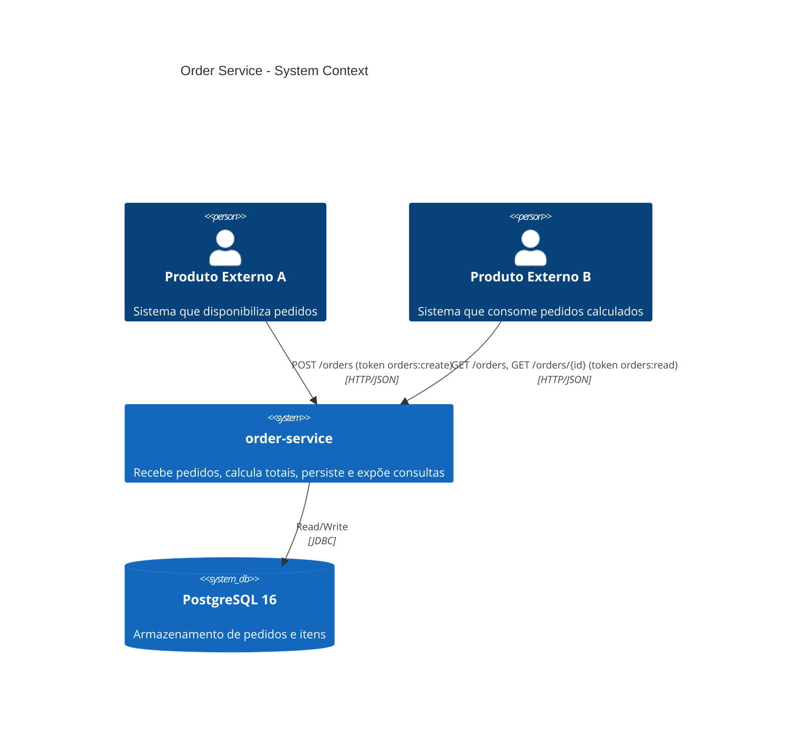
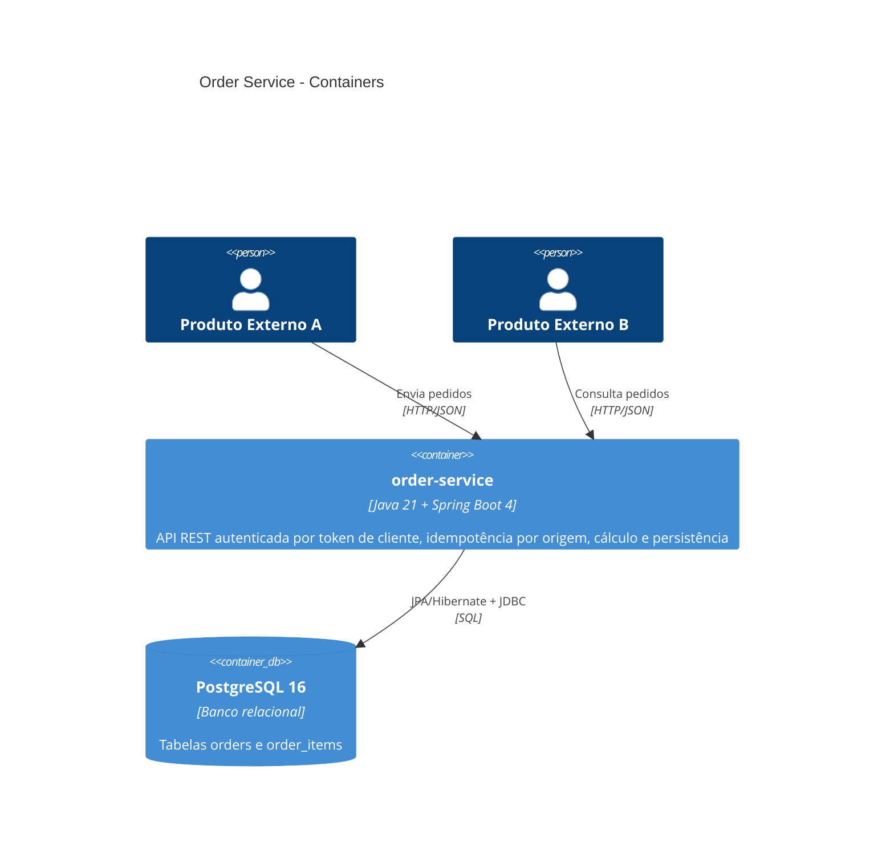
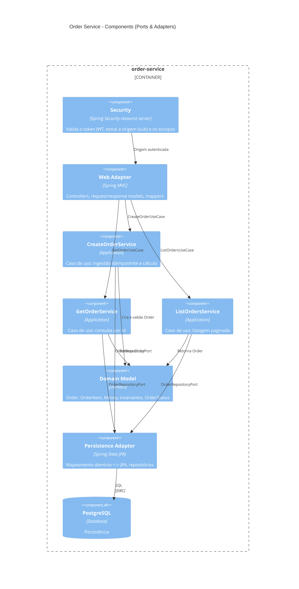

# Architecture

Este documento descreve a arquitetura do microserviço **order** usando o modelo **C4** (Context, Container, Component).

## Context (C4)

## Containers (C4)

## Components (C4)

## Notas relevantes

- **Clean Architecture**: domínio não depende de Spring/JPA. `Origin`, `Money` e `PayloadFingerprint` são value objects do domínio.
- **Segurança**: token de cliente obrigatório; a origem (`sub`) entra nos casos de uso como valor, e a porta de persistência só expõe leituras por origem (ADR-003).
- **Idempotência**: UNIQUE em `(origin, external_order_id)` + fingerprint do payload; insert em transação, leitura em transação separada e 409 em conflito (ADR-002).
- **Observabilidade**: `X-Correlation-Id` + MDC (logs), Actuator e contador `orders.ingestion` por desfecho, via porta `OrderIngestionMetrics`.
